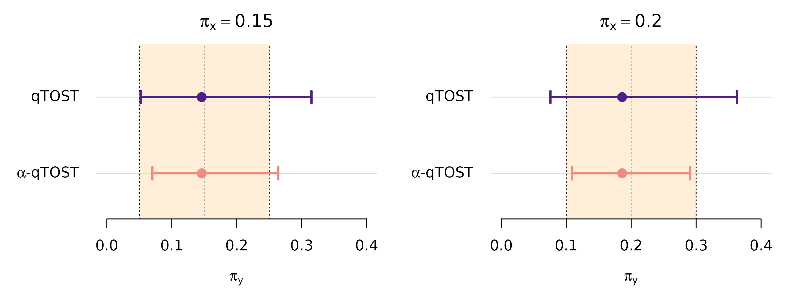
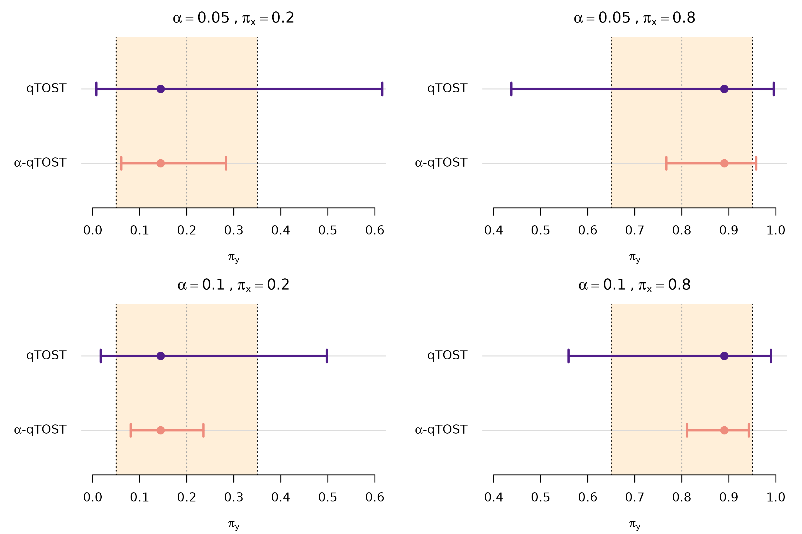

# Quantiles Equivalence Testing (2026)

This document describes how to reproduce the simulations and case
studies in Wu, J., Guerrier, S., Gou, S., Kalia, Y. N., and Insolia, L.
(2026), *Bridging the gap between experimental burden and statistical
power for quantiles equivalence testing*. The methods are implemented in
the `cTOST` R package through
[`qtost()`](https://stephaneguerrier.github.io/cTOST/reference/qtost.md)
and
[`compare_to_qtost()`](https://stephaneguerrier.github.io/cTOST/reference/compare_to_qtost.md);
see the [Quantile Equivalence
Testing](https://stephaneguerrier.github.io/cTOST/articles/quantile-equivalence.md)
article for an introduction.

The reproducibility material is provided in
[reproducibility/quantile/](https://github.com/stephaneguerrier/cTOST/tree/main/reproducibility/quantile),
and all paths below are relative to this path. The analyses used `cTOST`
version 1.1.0.

## Simulation studies

The simulation studies were run on the University of Geneva’s HPC
infrastructure. Each study used 50,000 Monte Carlo replications, split
across 5,000 single-CPU array tasks, with 10 replications per task. The
submission scripts use Bash and Slurm. Before running them on another
cluster, adapt the module-loading commands, partition and resource
requests (see `launch.sh` and `recomb.sh` below). Also ensure that
`cTOST` and `tictoc` are installed in the cluster’s R environment.

### Single quantile

The single-quantile simulation study compares the rejection rates of
qTOST and $`\alpha`$-qTOST across reference quantiles, equivalence
margins, sample sizes and variance ratios. The source code is in
`simulations/HPC/sim_univ/`. Namely:

| File | Purpose |
|:---|:---|
| `sim_options.R` | Defines the statistical design and calibration controls. |
| `sim_HPC_main.R` | Runs assigned replications and saves test decisions. |
| `out_HPC_combine.R` | Validates results and computes rejection probabilities. |
| `setting.sh` | Sets study, replication/task counts and output paths. |
| `all.sh` | Submits the array and schedules aggregation on success. |
| `launch.sh` | Loads the cluster R environment and starts an array task. |
| `recomb.sh` | Runs the R aggregation script and then cleanup. |
| `clean.sh` | Removes chunks and logs after verifying aggregation. |

#### Simulation setting 1: size

Setting 1 evaluates rejection rates at the two equivalence boundaries,
$`\pi_y = \pi_x - \delta`$ and $`\pi_x + \delta`$, to compare the test
size for the two procedures and reproduce Figure 3. The results can be
reproduced as follows:

``` sh
export n_simu=50000 n_array=5000
sim_setting=1 bash simulations/HPC/sim_univ/all.sh
```

The inline `sim_setting=1` selects the study without editing
`setting.sh`. The `all.sh` script submits the aggregation job,
`recomb.sh`, with a dependency on successful completion of the
simulation array. After aggregation succeeds, `clean.sh` removes the
temporary replication chunks and individual task logs, while retaining
the combined results. The submission scripts refuse to reuse a nonempty
output directory (so keep previous outputs separately before rerunning
the same setting).

Once the job is completed, the combined results are saved in:

``` text
simulations/HPC/sim_univ/sim_HPC_out/sim_setting_1/
  results_sim_setting_size_1_n_simu_50000_n_array_5000.rdata
```

This file contains `sol_TOST_avg` and `sol_alphaTOST_avg`, the estimated
rejection probabilities (expressed as percentages) for qTOST and
$`\alpha`$-qTOST, respectively. Both are `4 x 3 x 4 x 2 x 2` arrays,
indexed by $`n_y`$, $`n_x/n_y`$, quantile/margin pair, variance ratio
and equivalence boundary. For example, inspect the results with:

``` r

load(paste0("simulations/HPC/sim_univ/sim_HPC_out/sim_setting_1/",
            "results_sim_setting_size_1_n_simu_50000_n_array_5000.rdata"))
dim(sol_TOST_avg)
dimnames(sol_TOST_avg)
range(sol_alphaTOST_avg - sol_TOST_avg)
```

The last command gives the range of differences in rejection rates, in
percentage points. The aggregation report, `report_recomb_HPC.Rout`, is
retained in the same `sim_setting_1/` output directory.

Then, to reproduce Figure 3, run:

``` r

source("simulations/fig_3_heatmap_diff_size.R")
```

For each design and procedure, the figure displays the larger rejection
percentage at the two simulated boundaries, with a Monte Carlo tolerance
band around the nominal level of 5%.

By default, `tikzPlot = 0` generates figures on the active R graphics
device. To regenerate the publication-style files, set `tikzPlot = 1`
inside each plotting script before sourcing it, and install `tikzDevice`
plus a working LaTeX distribution. Create the `tex/` subfolder if
needed, so that each generated `.tex` file can then be compiled to PDF.
For instance:

``` r

install.packages("tikzDevice")
dir.create("tex", showWarnings = FALSE)
```

``` sh
latexmk -pdf -outdir=tex tex/fig3.tex
```

#### Simulation setting 2: power and type-I error

Setting 2 uses the same job submission, aggregation and cleanup
workflow. It evaluates rejection probabilities over 50 equally spaced
values of $`\theta = \Phi^{-1}(\pi_y)`$, from
$`\Phi^{-1}(\pi_x - 1.2\delta)`$ to $`\Phi^{-1}(\pi_x + 1.2\delta)`$,
covering the equivalence region and nearby null values. In this case,
keep the same `n_simu` and `n_array` values and change the Bash variable
`sim_setting`:

``` sh
export n_simu=50000 n_array=5000
sim_setting=2 bash simulations/HPC/sim_univ/all.sh
```

After aggregation, the output file is:

``` text
simulations/HPC/sim_univ/sim_HPC_out/sim_setting_2/
  results_sim_setting_2_n_simu_50000_n_array_5000.rdata
```

It contains the same two objects, `sol_TOST_avg` and
`sol_alphaTOST_avg`, with the same units and dimension order. The last
dimension now indexes 50 grid positions, giving `4 x 3 x 4 x 2 x 50`
arrays. To reproduce the original Figures 1–2 and S1–S6, run:

``` r

source("simulations/fig_1_heatmap_diff_pow.R")  # Figures 1 and S1
source("simulations/fig_2_power_curves.R")      # Figures 2 and S2-S6
```

Figures 1 and S1 show the gain of $`\alpha`$-qTOST over qTOST in
percentage points. Figures 2 and S2–S6 show the curves against
$`\pi_y`$, with the nominal level and equivalence limits as reference
lines.

### Multiple quantiles

The multiple-quantile simulation study compares the rejection rates of
qTOST and $`\alpha`$-qTOST when assessing two reference quantiles
jointly. The source code is in `simulations/HPC/sim_mvt/`. This follows
the same workflow and code structure as the single-quantile setup
presented above.

Here, the two reference quantile levels $`\pi_x = (0.20, 0.80)`$ are
assessed jointly, with margin $`\delta = 0.15`$, and the overall
declaration of equivalence requires both quantile assessments to be
satisfied. Variance ratio $`\gamma=1`$ and nominal level $`\alpha=0.05`$
were considered in this study, which evaluates a $`50
\times 50`$ grid of transformed parameter pairs $`\theta_1`$ and
$`\theta_2`$. The design and calibration settings are defined in this
directory’s `sim_options.R`.

The variable `sim_setting` determines the sample size:

| `sim_setting` | Observations per group | Figure |
|:--------------|:-----------------------|:-------|
| `1`           | 30                     | 4      |
| `2`           | 10                     | S7     |
| `3`           | 50                     | S8     |

To reproduce the simulation results, run:

``` sh
export n_simu=50000 n_array=5000
sim_setting=1 bash simulations/HPC/sim_mvt/all.sh
sim_setting=2 bash simulations/HPC/sim_mvt/all.sh
sim_setting=3 bash simulations/HPC/sim_mvt/all.sh
```

The combined results are saved separately for each setting, namely:

``` text
simulations/HPC/sim_mvt/sim_HPC_out/sim_setting_1/
  results_mvt_sim_setting_1_n_simu_50000_n_array_5000.rdata
  
simulations/HPC/sim_mvt/sim_HPC_out/sim_setting_2/
  results_mvt_sim_setting_2_n_simu_50000_n_array_5000.rdata

simulations/HPC/sim_mvt/sim_HPC_out/sim_setting_3/
  results_mvt_sim_setting_3_n_simu_50000_n_array_5000.rdata
```

Each file contains `sol_TOST_avg` and `sol_piTOST_avg`, the rejection
probabilities for qTOST and $`\alpha`$-qTOST, respectively. These are
`50 x 50` matrices, with rows indexing the second transformed parameter
and columns indexing the first.

Once all three combined results are available, Figures 4, S7 and S8 can
be obtained by running:

``` r

source("simulations/fig_4_pow_heatmap_mvt.R")
```

Each figure displays the rejection probabilities of the two procedures
across the parameter grid, their difference, and histograms of rejection
rates on the equivalence-region boundary.

## Case studies

The source code to reproduce the two case studies is provided in
`case_study/`. The full analyses were run locally using R version 4.4.3,
and took around 2 minutes in total on a standard laptop.

### Case study 1: A bridging clinical trial across gender populations

The first case study compares plasma trough concentrations of tipranavir
between male and female patients using summary statistics from [Table 5
of the FDA drug
label](https://www.accessdata.fda.gov/drugsatfda_docs/label/2024/021814s030lbl.pdf).
The reference group comprises 106 male patients, and the test group
comprises 14 female patients.

Assuming lognormal concentrations, the log-scale means and standard
deviations were reconstructed by moment matching. The complete analysis
is in `case_study/case_study_hiv.R`. It evaluates 191 reference quantile
levels from 0.11 to 0.30 in steps of 0.001, at nominal level 0.05 and
margin 0.10.

To reproduce the original analysis, run:

``` r

source("case_study/case_study_hiv.R")  # Figures 5 and 6
```

The results are stored in the `191 x 3` matrices `res` and `res_star`
for qTOST and $`\alpha`$-qTOST, respectively. Rows index reference
quantile levels, and columns give the lower interval endpoint, estimated
probability and upper endpoint. Figure 5 displays the results at two
(separately assessed) quantile reference levels $`\pi_x=0.15`$ and
$`\pi_x=0.20`$. Figure 6 shows intervals across a larger range. Also in
this case, set `tikzPlot = 1` inside the script to write `tex/fig5.tex`
and `tex/fig6.tex`, then compile them as described above.

As an illustration, Figure 5 can be reproduced as follows.

First load and transform the data:

``` r

# Original-scale means, standard deviations and sample sizes
mu_x = 35.6
sd_x = 16.7
n_x = 106
mu_y = 41.6
sd_y = 24.3
n_y = 14

# Log-scale summaries
x = list(mean = log(mu_x^2 / sqrt(mu_x^2 + sd_x^2)),
         sd = sqrt(log(1 + sd_x^2 / mu_x^2)), n = n_x)
y = list(mean = log(mu_y^2 / sqrt(mu_y^2 + sd_y^2)),
         sd = sqrt(log(1 + sd_y^2 / mu_y^2)), n = n_y)
```

Then specify the designs and obtain the qTOST and the $`\alpha`$-qTOST
assessments:

``` r

library(cTOST)

pi_x = c(0.15, 0.20)
alpha = 0.05
delta = 0.10

hiv_qtost = lapply(pi_x, function(p) {
  qtost(x, y, pi_x = p, delta = delta, alpha = alpha,
        method = "unadjusted")
})

hiv_alpha_qtost = lapply(pi_x, function(p) {
  qtost(x, y, pi_x = p, delta = delta, alpha = alpha,
        method = "alpha", B = 100000, seed = 12345,
        tol = .Machine$double.eps)
})
```

The results at each reference quantile can also be compared directly:

``` r

compare_to_qtost(hiv_alpha_qtost[[1]])  # 15th percentile
#> qTOST: ✖ Can't accept quantile (bio)equivalence
#> alpha-qTOST: ✖ Can't accept quantile (bio)equivalence
#> 
#> Equiv. Region:   |------------------------|       
#> qTOST:          (--------------x------------------)
#> alpha-qTOST:      (------------x------------)      
#> 
#>                CI - low      CI - high
#> qTOST:         0.05208       0.31514
#> alpha-qTOST:   0.07011       0.26390
#> 
#> Equiv. lim. = dw/up 0.05000 0.25000
compare_to_qtost(hiv_alpha_qtost[[2]])  # 20th percentile
#> qTOST: ✖ Can't accept quantile (bio)equivalence
#> alpha-qTOST: ✔ Accept quantile (bio)equivalence
#> 
#> Equiv. Region:      |---------------------|       
#> qTOST:          (--------------x------------------)
#> alpha-qTOST:       (-----------x----------)        
#> 
#>                CI - low      CI - high
#> qTOST:         0.07568       0.36283
#> alpha-qTOST:   0.10857       0.29065
#> 
#> Equiv. lim. = dw/up 0.10000 0.30000
```

Finally, display the confidence intervals and equivalence margins:

``` r

plot_intervals = function(qtost_fit, alpha_qtost_fit, pi_x, delta,
                          k = 1, xlim, main) {
  ci = rbind(qtost_fit$ci[k, ], alpha_qtost_fit$ci[k, ])
  estimate = c(qtost_fit$pi_y_hat[k], alpha_qtost_fit$pi_y_hat[k])
  cols = c("#501d8a", "#ee8c7d")
  ypos = c(2, 1)

  plot(NA, xlim = xlim, ylim = c(0.4, 2.7), axes = FALSE,
       xlab = expression(pi[y]), ylab = "", main = main)
  rect(pi_x - delta, 0.4, pi_x + delta, 2.7,
       col = adjustcolor("#FF9900", alpha.f = 0.15), border = NA)
  abline(h = ypos, col = "grey85")
  abline(v = pi_x, col = "grey65", lty = 3)
  abline(v = pi_x + c(-delta, delta), lty = 3)
  arrows(ci[, 1], ypos, ci[, 2], ypos, angle = 90, code = 3,
         length = 0.07, col = cols, lwd = 2.5)
  points(estimate, ypos, pch = 16, col = cols, cex = 1.5)
  axis(1)
  axis(2, at = ypos, labels = expression("qTOST", alpha*"-qTOST"),
       las = 1, tick = FALSE)
}

old_par = par(mfrow = c(1, 2), mar = c(4, 5.5, 2.5, 1), yaxs = "i")

for (i in seq_along(pi_x)) {
  plot_intervals(hiv_qtost[[i]], hiv_alpha_qtost[[i]],
                 pi_x = pi_x[i], delta = delta, xlim = c(0, 0.4),
                 main = bquote(pi[x] == .(pi_x[i])))
}
par(old_par)
```



While neither procedure establishes equivalence at the 15th percentile,
the $`\alpha`$-qTOST interval is entirely inside the equivalence margins
and establishes equivalence at the 20th percentile when the qTOST fails
to do so.

### Case study 2: Demonstrating inter-operator reproducibility

The second case study compares the cutaneous delivery of a compound
measured by two operators using the same experimental protocol. The
`biodistribution` dataset contains six independent observations per
operator. Its `X` and `Y` columns are already on the logarithmic scale
and represent the reference and test operators, respectively.

The complete analysis is in `case_study/case_study_lad_mvt.R`, which
jointly tests the 20th and 80th reference percentiles over 20 nominal
significance levels from 0.01 to 0.20, with margin 0.15. This follows
the same workflow as the one described for the first case study. To
reproduce the complete analysis, run:

``` r

source("case_study/case_study_lad_mvt.R")  # Figures 7 and 8
```

The results are stored in `sol_qtost` and `sol_alpha_qtost`, each a
`2 x 3 x 20` array indexed by reference quantile, lower
endpoint/estimate/upper endpoint, and nominal level. Figure 7 displays
the significance levels 0.05 and 0.10. Figure 8 shows intervals across a
larger range.

As an illustration, Figure 7 can be reproduced as follows.

First load the data:

``` r

library(cTOST)

data(biodistribution)
x = biodistribution$X
y = biodistribution$Y
```

Then jointly assess the two reference quantiles at nominal significance
levels 0.05 and 0.10. The designs and the qTOST and the $`\alpha`$-qTOST
assessments can be obtained as follows:

``` r

pi_x = c(0.2, 0.8)
delta = 0.15
alphas = c(0.05, 0.1)

lad_qtost = lapply(alphas, function(a) {
  qtost(x, y, pi_x = pi_x, delta = delta, alpha = a,
        method = "unadjusted")
})

lad_alpha_qtost = lapply(alphas, function(a) {
  qtost(x, y, pi_x = pi_x, delta = delta, alpha = a,
        method = "alpha", B = 10000, seed = 12345,
        tol = sqrt(.Machine$double.eps), max_iter = 5,
        tolpower = 1e-3, MC_sup = TRUE)
})
```

Finally, display the confidence intervals and equivalence margins, with
reference quantiles in columns and nominal levels in rows:

``` r

plot_intervals = function(qtost_fit, alpha_qtost_fit, pi_x, delta,
                          k = 1, xlim, main) {
  ci = rbind(qtost_fit$ci[k, ], alpha_qtost_fit$ci[k, ])
  estimate = c(qtost_fit$pi_y_hat[k], alpha_qtost_fit$pi_y_hat[k])
  cols = c("#501d8a", "#ee8c7d")
  ypos = c(2, 1)

  plot(NA, xlim = xlim, ylim = c(0.4, 2.7), axes = FALSE,
       xlab = expression(pi[y]), ylab = "", main = main)
  rect(pi_x - delta, 0.4, pi_x + delta, 2.7,
       col = adjustcolor("#FF9900", alpha.f = 0.15), border = NA)
  abline(h = ypos, col = "grey85")
  abline(v = pi_x, col = "grey65", lty = 3)
  abline(v = pi_x + c(-delta, delta), lty = 3)
  arrows(ci[, 1], ypos, ci[, 2], ypos, angle = 90, code = 3,
         length = 0.07, col = cols, lwd = 2.5)
  points(estimate, ypos, pch = 16, col = cols, cex = 1.5)
  axis(1)
  axis(2, at = ypos, labels = expression("qTOST", alpha*"-qTOST"),
       las = 1, tick = FALSE)
}

old_par = par(mfrow = c(2, 2), mar = c(4, 5.5, 2.5, 1), yaxs = "i")

for (i in seq_along(alphas)) {
  for (k in seq_along(pi_x)) {
    plot_intervals(lad_qtost[[i]], lad_alpha_qtost[[i]],
                   pi_x = pi_x[k], delta = delta, k = k,
                   xlim = if (k == 1) c(0, 0.6) else c(0.4, 1),
                   main = bquote(alpha == .(alphas[i]) ~ "," ~
                                 pi[x] == .(pi_x[k])))
  }
}
par(old_par)
```



Equivalence is established only when, at a given significance level,
both intervals lie within their respective equivalence margins. Thus,
neither procedure establishes joint equivalence at the 5% nominal level.
At 10%, $`\alpha`$-qTOST establishes joint equivalence, whereas qTOST
does not.

## References

Wu, J., Guerrier, S., Gou, S., Kalia, Y. N., and Insolia, L. (2025).
*Bridging the gap between experimental burden and statistical power for
quantiles equivalence testing*.
[arXiv:2510.17514](https://doi.org/10.48550/arXiv.2510.17514).
